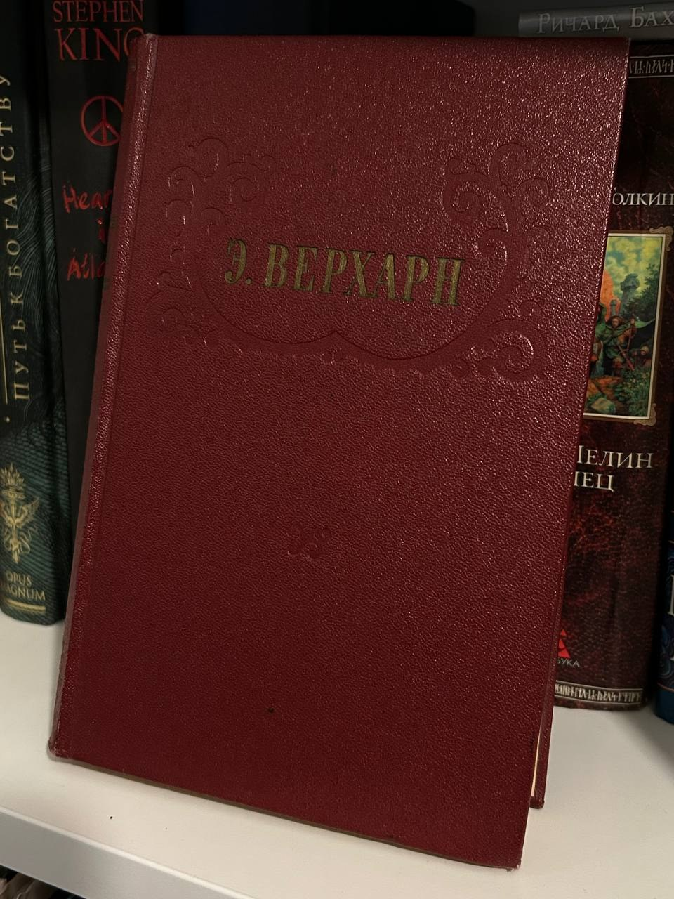
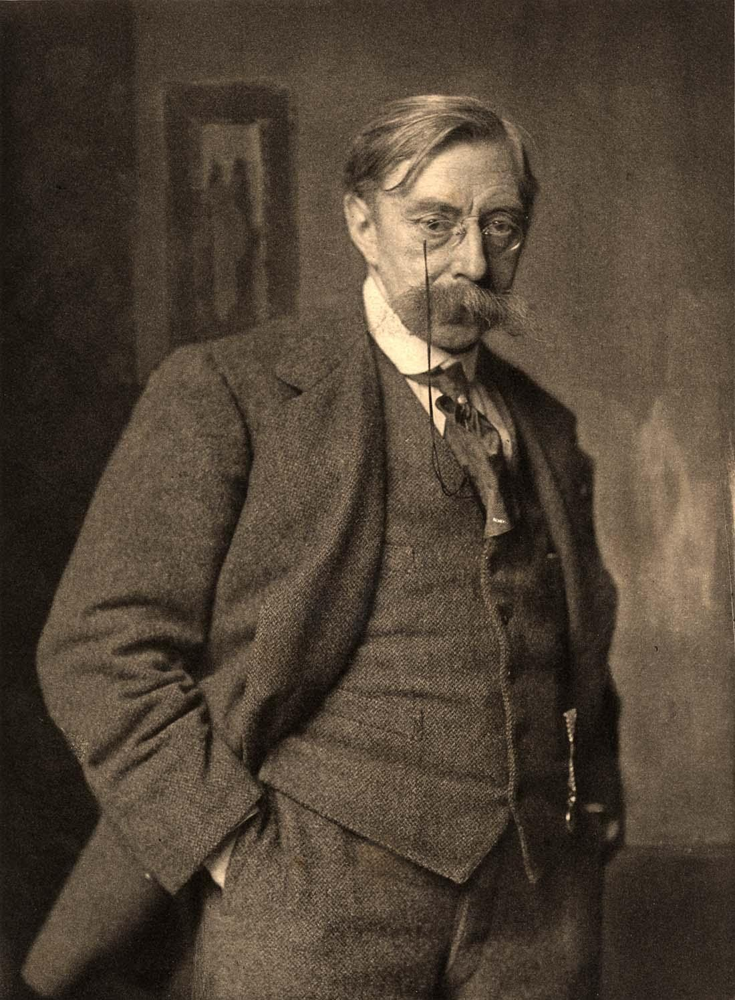

🎧 Seether - <a href="https://www.youtube.com/watch?v=ET3-t1jFmo0" target="_blank" rel="noopener">Fine Again</a>

Если бы я сейчас оказался в школе и мне нужно было выйти к доске и прочитать своё любимое стихотворение, моя учительница по литературе, наверное, очень удивилась.

**«Меч» Эмиля Верхарна.**

> *С насмешкой над моей гордынею бесплодной\
> Мне некто предсказал, державший меч в руке:\
> Ничтожество с душой пустою и холодной,\
> Ты будешь прошлое оплакивать в тоске.*
>
> *В тебе прокиснет кровь твоих отцов и дедов,\
> Стать сильным, как они, тебе не суждено;\
> На жизнь, ее скорбей и счастья не изведав,\
> Ты будешь, как больной, смотреть через окно.*
>
> *И кожа ссохнется, и мышцы ослабеют,\
> И скука въестся в плоть, желания губя,\
> И в черепе твоем мечты окостенеют,\
> И ужас из зеркал посмотрит на тебя.*
>
> *Себя преодолеть! Когда б ты мог! Но, ленью\
> Расслаблен, стариком ты станешь с юных лет;\
> Чужое и свое, двойное утомленье\
> Нальет свинцом твой мозг и размягчит скелет.*
>
> *Заплещет вещее и блещущее знамя, —\
> О, если бы оно и над тобой взвилось! —\
> Увы! Ты истощишь свой дух над письменами,\
> Их смысл утерянный толкуя вкривь и вкось.*
>
> *Ты будешь одинок! — В оцепененье дремы\
> Прикован будет твой потусторонний взгляд\
> К минувшей юности, — и радостные громы\
> Далеко в стороне победно прогремят!*
>
> Перевод М. Донского

Познакомился я с ним довольно необычным способом, через творчество группы «Чёрный Обелиск». Анатолий Крупнов положил на музыку стихи бельгийского поэта конца XIX века, и получилась интереснейшая композиция, в которой тяжёлый метал делает и без того мощный текст ещё сильнее.

🎧 <a href="https://www.youtube.com/watch?v=cfyeWIkUvVc" target="_blank" rel="noopener">Анатолий Крупнов. Меч</a>

Для меня это одновременно стихотворение-мотиватор и стихотворение-предостережение. В нём довольно жёстко описан один из возможных вариантов будущего, если пустить собственную жизнь на самотёк и не решаться что-то делать, смотреть со стороны.

Я читаю в нём и про лень, отсутствие дисциплины, и про увлечение теорией, когда изучение очередного источника подменяет реальные действия (как же жизненно). Про жизнь воспоминаниями, сожаления о прошлом и осознание упущенных возможностей. И при этом перевод создает ту самую красочную картину мрачного диалога и буквально осязаемое упущенное время.

> *В тебе прокиснет кровь твоих отцов и дедов,\
> Стать сильным, как они, тебе не суждено.*

Почему-то эти строки регулярно всплывают у меня в голове, особенно когда слушаю рассказы людей старшего поколения о том, как они справлялись с жизненными трудностями. Или когда наблюдаю за людьми, которые умеют своими руками что-то создавать и чинить.

А я уже с трудом представляю, как буду разбираться с какой-нибудь технической проблемой без помощи ChatGPT.

Справедливости ради, многие привычные нам вещи стали гораздо сложнее. Даже чтобы самостоятельно разобраться в устройстве современного автомобиля, нужно преодолеть совершенно другой порог входа, чем пару десятилетий назад.

Но иногда всё равно возникает ощущение, что мы немного размякли. Всё больше времени проводим за компьютерами, обрастаем удобствами и всё реже сталкиваемся с необходимостью что-то делать самостоятельно.

И мне интересно, какие способности мы постепенно теряем в обмен на весь этот комфорт и какие возможности при этом приобретаем.

---

Я не очень часто читаю поэзию, но при этом у меня есть несколько сборников стихотворений, которыми я дорожу и которые купил именно потому, что когда-то меня зацепило отдельное стихотворение или стиль автора. Есть томики Бродского и Роберта Фроста, сборник переводов Вильгельма Левика и сборник американской поэзии, хотя целиком я их так и не прочитал.

В какой-то момент я даже купил себе сборник стихов Верхарна.

Советское издание 1955 года, Гослитиздат, 14 рублей. Отдельное удовольствие держать в руках томик, которому уже больше семидесяти лет.

До знакомства с «Мечом» я вообще ничего не знал об Эмиле Верхарне.

Оказалось, это бельгийский поэт-символист, писавший по-французски.

По стихам видно, как менялось его восприятие мира.

От мрачных стихотворений, наполненных тревогой и ощущением обречённости:

**1888 год. «Исступленно»**

> *Нет цели, нет надежд, нет силы; ну так что же!\
> Есть ненависть, что ржет под шпорами судьбы;*
>
> Перевод М. Донского

К восхищению жизнью, человеческими возможностями и вере в будущее:

**1906 год. «Радость»**

> *Благодарю тебя, моя земная плоть,\
> За то, что ты пока проворна и упряма,\
> За то, что, жизнь любя, ты держишься так прямо\
> И можешь старика во мне перебороть!*
>
> Перевод Ю. Александрова

Интересно, как эти строки перекликаются с «Мечом». Спустя восемнадцать лет поэт возвращается к теме старения и жизненной силы, но уже с совершенно другим ощущением жизни.

Грустно было узнать, как закончилась его собственная жизнь. 27 ноября 1916 года, возвращаясь после выступления, Верхарн попал под поезд на вокзале в Руане. Какая-то совершенно нелепая и трагическая случайность.

---

Вообще, мне очень нравится, каким путём в мою жизнь иногда попадают книги.

Слушаешь русский метал, спустя какое-то время покупаешь советский томик бельгийского символиста и обнаруживаешь целый пласт литературы, о существовании которого раньше даже не подозревал.

А теперь, когда у меня наконец появился книжный шкаф и удалось расставить книги по полкам, можно просто взять этот томик, открыть на случайной странице, прочитать несколько стихотворений и наслаждаться тем, как точно подобранные слова ярко выражают знакомые мысли и ощущения.
