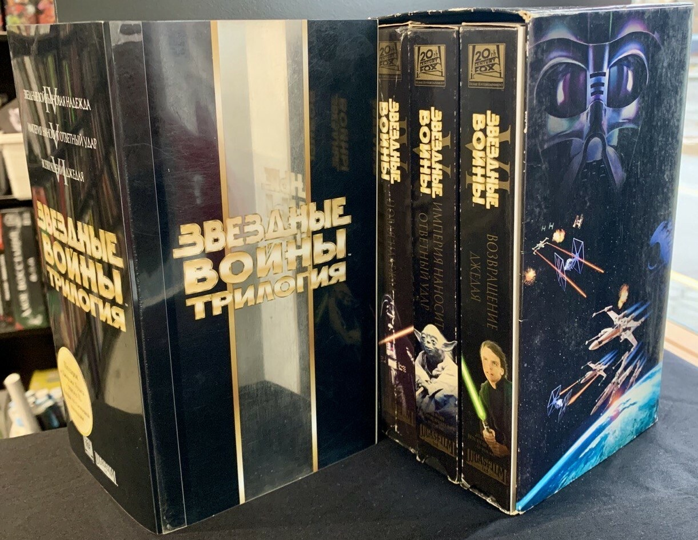

🎧 God Is an Astronaut - <a href="https://www.youtube.com/watch?v=lbdoZKyLRZw" target="_blank" rel="noopener">Fragile</a>

Знакомо это неприятное чувство, когда на новой вещи появляется первая царапина?

Купил телефон, случайно уронил, и на корпусе уже небольшая вмятина. На любимой гитаре появился след от удара, новые ботинки где-то потёрлись, а любимая домашняя футболка после стирки потеряла цвет.

Вроде ничего страшного: вещь работает и её свойства не изменились, но внутри всё равно расстраиваешься, помня её идеальной в первые дни после покупки.

---

В детстве у меня было одно особенно яркое переживание на эту тему.

Нам с братом на Новый год подарили трилогию «Звёздных войн» на видеокассетах. Три кассеты в красивой картонной упаковке, а сверху ещё пластиковый бокс. Мы смотрели и пересматривали, и я очень дорожил этим набором.

Однажды я вернулся из школы и узнал, что бабушка выбросила коробку в мусор, решив, что это какая-то ненужная картонка.

Помню, как доставал её оттуда мокрую и грязную, и как меня накрыло сразу ужасом, злостью и обидой. Что потом стало с коробкой и кассетами, я уже не помню, а само ощущение осталось до сих пор.

Тогда ценность вещи для меня была очень сильно связана с её первоначальным, идеальным состоянием, и любое повреждение воспринималось как невосполнимая потеря.

---

Очень чётко помню момент, после которого я начал осознанно смотреть на вещи иначе.

Мы обустраивали новое жильё и заказали в IKEA белый комод: простой, минималистичный, с гладкими фасадами, он отлично вписывался в наше пространство.

Когда я начал его собирать, на передней панели одного из ящиков обнаружился сучок. Прямо посреди гладкой белой поверхности выделялся кусочек ветки, которого там быть не должно.

Первая мысль была вполне ожидаемой: блин, обидно, такой дефект.

А потом пришла другая: теперь у этого комода есть своя особенность. Таких комодов выпустили тысячи, а мой вот такой, с сучком на фасаде, и мне вдруг стало нравиться, что он немного отличается от остальных.

Проходя мимо, я стал бросать взгляд на этот сучок и мысленно к нему возвращаться. Он стал знакомой деталью, по которой я узнаю именно свою вещь.

---

Возможно, в тот момент в памяти всплыло то, что я когда-то слышал о японской эстетике ваби-саби (侘寂), где к вещам относятся похоже.

Ваби-саби выросла из дзен-буддизма и японской чайной церемонии. Одним из главных её популяризаторов считают чайного мастера <a href="https://ru.wikipedia.org/wiki/%D0%A1%D1%8D%D0%BD-%D0%BD%D0%BE_%D0%A0%D0%B8%D0%BA%D1%8E" target="_blank" rel="noopener">Сэн-но Рикю</a> (1522–1591). Он предпочитал простые и грубые вещи японской работы дорогой и модной тогда китайской посуде, а вместе с мастером Танакой Тёдзиро создал чаши раку.

Если сильно упростить, ваби-саби предлагает замечать красоту в простоте, несовершенстве и следах времени: в старой чашке с неровной глазурью, в потемневшем дереве, в камне, покрытом мхом.

Мы же обычно воспринимаем новую вещь как эталон, с которым потом сравниваем все её следующие состояния, и тогда любое изменение оказывается ухудшением. Ваби-саби предлагает другой взгляд: вещь становится интереснее по мере того, как проживает свою историю.

. Чайная чаша, начало XIX века. Метрополитен-музей")

Чайная чаша раку с чёрной глазурью. Работа мастера Раку Рёню (1756–1834), начало XIX века, хранится в <a href="https://www.metmuseum.org/art/collection/search/62886" target="_blank" rel="noopener">Метрополитен-музее</a>.

Обратите внимание на неровный край, асимметрию и неоднородную глазурь. Всё то, что при промышленном производстве могли бы посчитать недостатками, здесь становится частью художественной выразительности.

---

После истории с комодом я стал замечать, что применяю похожий принцип и к другим вещам. Хотя привязанности, конечно, никуда не делись.

У меня есть любимое пончо, очень уютная вещь. Люблю сидеть в нём в прохладной комнате.

Так совпало, что кошка тоже его любит. Она запрыгивает на колени, я её глажу, и на материале остаются небольшие зацепки. Немного грустно, что вещь потеряла идеальный вид, но теперь эти зацепки напоминают мне о моментах, когда ко мне приходит кошка, а они мне дороже потерянного первоначального вида одежды. Пончо всё так же греет, и я всё так же люблю его носить.

Недавно приехал новый компьютерный стол, тоже из IKEA, и на углу столешницы обнаружилась небольшая вмятина, видимо, от транспортировки. Можно было расстроиться, что привезли неидеальный стол, но первой мыслью было: ну вот, значит, у меня будет такой стол, с вмятиной на углу. Мой.

---

Постепенно я начал думать, что с нами происходит примерно то же самое. Мы меняемся, стареем, жизнь наполняется в том числе неидеальными моментами, и какие-то изменения нам нравятся, а какие-то совсем нет.

Недавно мне поставили коронку на зуб. Конечно, хотелось бы до конца жизни иметь ровные, красивые и белые зубы, но теперь один из них вот такой, и это тоже часть меня.

Кажется, важно продолжать любить то, что изменилось.

Мы привязываемся к идеальному образу вещей, а иногда и самих себя, и когда реальность начинает от него отличаться, воспринимаем это как потерю. При этом у вещей и людей нет обязанности навсегда оставаться такими, какими они были в момент, когда мы их полюбили. С ними происходит жизнь.

> Любого, с кем знакомился, больше нет\
> Мы не фото, мы — происшествие, мы — сюжет\
> И пока вечность к нам в дом не вломится\
> Не переставай со мною знакомиться
>
> — ГРОТ, «Уже не я»

И, возможно, именно те особенности, которые мы привыкли считать недостатками, со временем делают их узнаваемыми и дорогими.

К мебели, одежде и любимым вещам я это применять уже научился. С собой, кажется, ещё предстоит разобраться.
